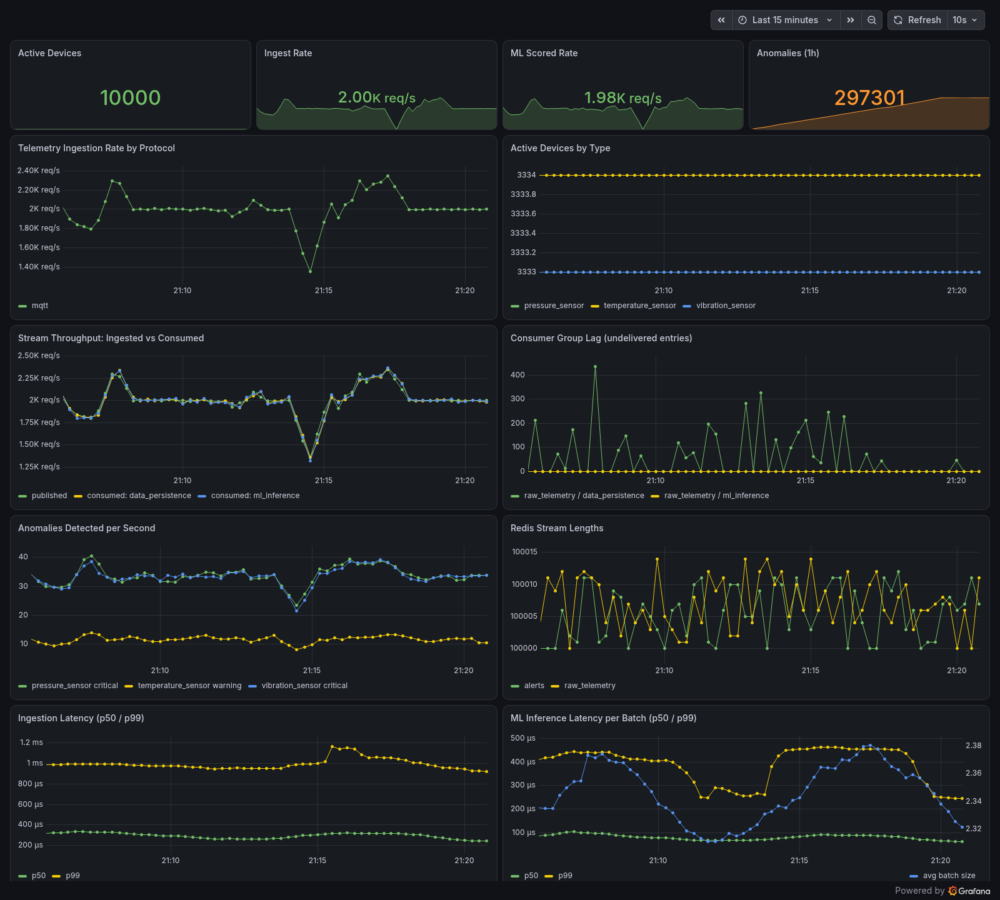
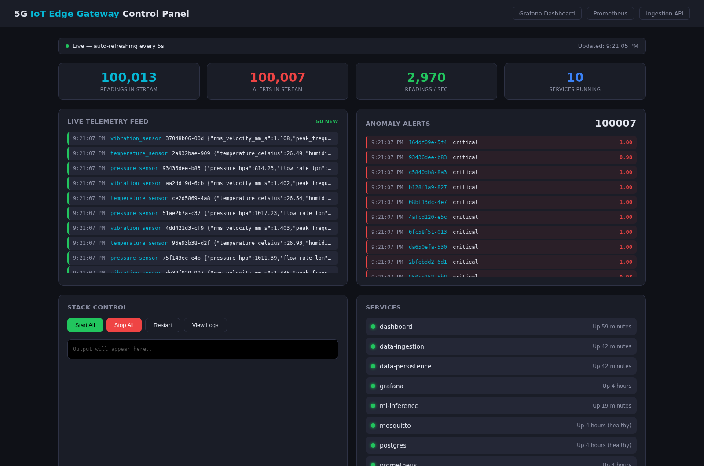

# 5G IoT Edge Gateway

An edge IoT gateway built with FastAPI, MQTT, CoAP and Redis Streams. Simulated devices publish telemetry over MQTT, CoAP or HTTP; a PyTorch autoencoder served on ONNX Runtime flags anomalies in real time; Prometheus and Grafana monitor the whole pipeline.

## Results

Measured on a single machine with Docker Compose, 10,000 simulated devices over MQTT (one reading every 5 s each):



| Metric | Result |
|---|---|
| Active devices | 10,000 |
| Ingest rate | ~2,000 readings/s, every reading scored by the ML service |
| Consumer lag (ml_inference, data_persistence) | 0 |
| Ingestion latency per reading | p50 0.24 ms, p99 0.92 ms |
| ONNX Runtime latency per scoring batch | p50 0.06 ms, p99 0.24 ms |
| Alert precision (live, vs. simulator ground truth) | 99.99% (1 false alert out of 88,673) |
| Anomaly recall (live) | 79.6% (pressure and vibration 100%) |
| Test suite | 15 passed, 1 skipped (needs cloud-api, not in the Compose stack) |

Recall is limited by temperature sensors: the simulator's "stuck" and "drift" temperature anomalies stay inside the normal range, so a single-reading detector can only catch spikes (see [Anomaly Detection Model](#anomaly-detection-model)).

## Prerequisites

- **Docker** 24+ with Docker Compose v2

```bash
docker --version && docker compose version
```

---

## Quick Start (One Command)

```bash
bash start.sh
```

This script:
1. Creates `.env` from `.env.example` if missing
2. Cleans up stale containers and checks for port conflicts
3. Builds and starts all services (infrastructure, edge services, monitoring, dashboard)
4. Waits for health checks and prints a summary with URLs

Once done, open **http://localhost:9000** to access the web dashboard.

---

## Manual Start (Step by Step)

If you prefer to start services manually instead of using `start.sh`:

```bash
# 1. Create .env from template (if not already done)
cp .env.example .env

# 2. Build and start all core services
docker compose up --build -d

# 3. Start the simulator (separate profile)
docker compose --profile simulate up -d simulator

# 4. Run tests (separate profile)
docker compose --profile test run --rm test-runner
```

To stop everything:

```bash
docker compose --profile simulate down   # stops simulator + all services
docker compose down -v                   # also removes data volumes
```

---

## Using the Web Dashboard (http://localhost:9000)

The dashboard is a single-page control panel for the entire system.



### Stats Row

Four counters at the top update in real time:
- **Readings in Stream** — entries currently held in the raw_telemetry Redis Stream (capped at ~100k)
- **Alerts in Stream** — entries currently held in the alerts stream (capped at ~100k)
- **Readings / sec** — arrival rate, from the stream's entries-added counter
- **Services Running** — number of healthy containers

### Live Telemetry Feed

The left panel shows a scrolling feed of the newest telemetry readings (the 50 most recent every 2 seconds, so it keeps up at any rate). Each entry shows the timestamp, device type, device ID, and sensor payload. A green left border indicates normal readings.

### Anomaly Alerts

The right panel shows anomaly detections from the ML inference service. Each alert displays the device ID, severity (warning/critical), and anomaly score. A red left border highlights alerts.

Both panels update automatically via WebSocket — no manual refresh needed.

### Stack Control

- **Start All** — builds and starts all services (excluding the dashboard itself)
- **Stop All** — stops all services
- **Restart** — stops then starts all services
- **View Logs** — fetches combined container logs

Output appears in the terminal box below the buttons.

### Services Panel

Shows all running containers with live health indicators:
- Green dot = running and healthy
- Yellow dot = starting up
- Red dot = stopped or errored

Status auto-refreshes every 5 seconds via WebSocket.

### Simulator

Configure and launch the IoT device fleet simulator:

| Parameter    | Default | Description                                    |
|--------------|---------|------------------------------------------------|
| Devices      | 50      | Number of simulated IoT sensors (tested at 10,000) |
| Interval (s) | 2       | Seconds between readings per device             |
| Anomaly Rate | 0.10    | Fraction of readings that are anomalous (0-1)   |

Click **Start Simulator** to launch, **Stop Simulator** to stop. The simulator sends MQTT telemetry through the full pipeline: MQTT -> data-ingestion -> Redis Stream -> ml-inference -> alerts.

### Test Runner

Click a button to run tests inside a dedicated container:
- **All Tests** — full pytest suite (integration + e2e)
- **Integration** — tests the telemetry pipeline (Redis streams, consumer groups)
- **E2E** — end-to-end tests (HTTP POST telemetry, health checks)
- **Load Test** — 30-second Locust load test simulating concurrent IoT devices

Results (pass/fail, full output) appear inline. The first run may take longer as the test container image is built.

### Service Logs

1. Select a service from the dropdown (or leave on "All Services")
2. Set how many tail lines to fetch (default 100)
3. Click **Fetch Logs**

---

## Service Endpoints

| Service             | URL                        | Purpose                                    |
|---------------------|----------------------------|--------------------------------------------|
| **Dashboard**       | http://localhost:9000      | Web control panel with live data feeds     |
| **Grafana**         | http://localhost:3000      | Monitoring dashboards (admin / admin)      |
| **Prometheus**      | http://localhost:9090      | Metrics store                              |
| **Data Ingestion**  | http://localhost:8001      | Telemetry API (MQTT + HTTP)                |
| **CoAP Ingestion**  | coap://localhost:5683/telemetry (UDP) | CoAP POST/PUT, JSON or CBOR      |
| **API Docs**        | http://localhost:8001/docs | Swagger UI for the ingestion API           |
| **ML Inference**    | (internal, port 8004)      | PyTorch autoencoder on ONNX Runtime (no host port) |

---

## Architecture Overview

```
Simulator (MQTT / CoAP / HTTP)
    |
    v
Mosquitto (MQTT Broker) / CoAP :5683 / HTTP :8001
    |
    v
Data Ingestion ──> Redis Stream (raw_telemetry) ──> ML Inference (PyTorch autoencoder on ONNX Runtime)
                       |                                  |
                       v                                  v
                  Data Persistence              Redis Stream (alerts)
                       |                                  |
                       v                                  v
                   PostgreSQL                     Dashboard (live feed)
                                                  Prometheus / Grafana
```

---

## Grafana Monitoring (http://localhost:3000)

Login: `admin` / `admin` (see the screenshot under [Results](#results))

Pre-configured with:
- **Prometheus** datasource (auto-provisioned)
- **IoT Gateway Overview** dashboard with panels for:
  - Active devices, ingest rate, ML scored rate, anomalies (stat row)
  - Telemetry ingestion rate per protocol (MQTT / CoAP / HTTP)
  - Active devices per type
  - Ingested vs consumed throughput per consumer group, and consumer-group lag (groups no consumer has joined, such as `alert_handler` without the coordination service, are left out)
  - Anomalies per device type and severity
  - Redis stream lengths
  - Ingestion latency and ML inference latency/batch size

---

## Anomaly Detection Model

The ml-inference image trains its model at build time (`services/ml-inference/Dockerfile`, stage `trainer`):

1. Generates 90k labelled readings with the simulator's own device classes (5% anomalies).
2. Trains the PyTorch `Autoencoder` (`services/ml-training/ml_training/architectures/autoencoder.py`) on normal readings only.
3. Calibrates the reconstruction-error threshold for best F1 on a held-out split.
4. Exports to ONNX, checks ONNX Runtime output against PyTorch, and writes `anomaly-autoencoder-v1.0.0.onnx` plus a `.json` sidecar (feature stats, threshold, test metrics).

The runtime image has ONNX Runtime only, without torch. The build log prints held-out precision/recall per device type; you can also read them inside the container:

```bash
docker compose exec ml-inference cat /app/model_store/anomaly-autoencoder-v1.0.0.json
```

To retrain locally: `bash scripts/train-baseline-model.sh`.

---

## Simulating Over CoAP

```bash
SIM_TRANSPORT=coap docker compose --profile simulate up -d simulator
```

---

## Environment Variables

Copy `.env.example` to `.env` (done automatically by `start.sh`). Defaults work for local development:

```env
POSTGRES_USER=iot_gateway
POSTGRES_PASSWORD=changeme
REDIS_URL=redis://redis:6379/0
MQTT_BROKER_HOST=mosquitto
JWT_SECRET=change-this-to-a-secure-random-string
LOG_LEVEL=INFO
```

The ML inference threshold is configured in `docker-compose.yml`:

```yaml
ml-inference:
  environment:
    ANOMALY_THRESHOLD: 0.5   # anomaly score above this triggers an alert
```

---

## Project Structure

```
iot-edge-gateway/
├── start.sh                # One-command setup script
├── docker-compose.yml      # All services, monitoring, and dashboard
├── .env.example            # Environment variable template
├── dashboard/              # Web UI (port 9000)
├── services/
│   ├── data-ingestion/     # MQTT + CoAP + HTTP telemetry ingestion
│   ├── data-persistence/   # Redis -> PostgreSQL writer
│   ├── ml-inference/       # ONNX Runtime anomaly detection (model trained at image build)
│   └── ml-training/        # PyTorch architectures + edge model training script
├── simulator/              # IoT device fleet simulator
├── shared/                 # Shared models, Redis client, observability
├── monitoring/
│   ├── prometheus/         # Prometheus config
│   └── grafana/            # Grafana provisioning and dashboards
├── tests/                  # Integration, E2E, and load tests
└── docs/                   # Documentation
```